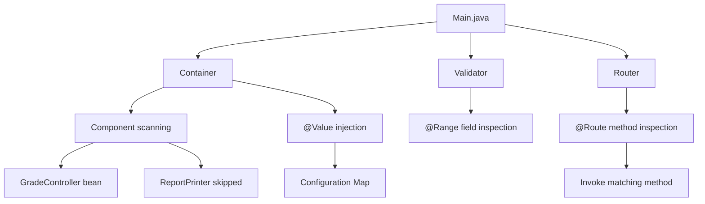
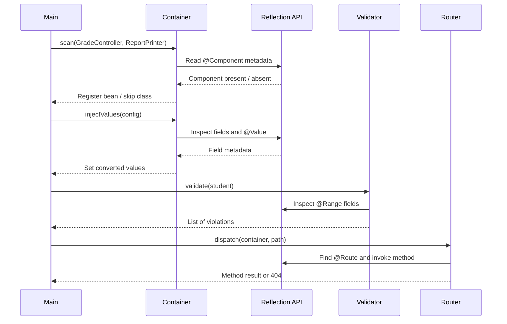

# CampusBoot — A Mini Annotation-Based Java Framework

<p align="center">
  <strong>Java Reflection • Custom Annotations • IoC Container • Value Injection • Validation • Routing</strong>
</p>

<p align="center">
  
  
  
</p>

> **A small educational framework that demonstrates the core ideas behind annotation-driven frameworks such as Spring.** CampusBoot uses only the Java standard library and Reflection; it does not depend on Spring or any third-party library.

---

## Student Information

| Field | Details |
|---|---|
| **Student Name** | Imran Hossen |
| **Student ID** | IT24063 |
| **Department** | Information and Communication Technology (ICT) |
| **University** | Mawlana Bhashani Science and Technology University (MBSTU) |
| **Assignment** | Java Reflection & Custom Annotations — CampusBoot |
| **Language** | Java 11+ |

## 1. Project Overview

CampusBoot is a miniature annotation-driven framework built to understand how frameworks can inspect Java classes at runtime and perform repetitive tasks automatically.

Instead of manually creating every object, assigning configuration values, checking fields, and calling controller methods, CampusBoot reads custom annotations using the Java Reflection API and performs those operations centrally.

The project implements four custom annotations:

- `@Component` — marks a class for container management.
- `@Value` — injects a configuration value into a field.
- `@Range` — validates an integer field against a minimum and maximum.
- `@Route` — associates a URL path with a method.

The implementation follows the supplied assignment requirements and uses no external libraries.

## 2. Learning Objectives

After completing this project, a student should be able to:

1. Define custom annotations with `@Target` and `@Retention`.
2. Explain why runtime retention is required for reflection-based processing.
3. Inspect classes, fields, and methods using `Class`, `Field`, and `Method`.
4. Create and register objects through a basic Inversion of Control (IoC) container.
5. Inject `String` and `int` configuration values into private fields.
6. Validate object fields using annotation metadata.
7. Invoke methods dynamically based on a requested route.
8. Relate a small custom framework to concepts used by Spring.

## 3. Technology Stack

| Technology | Usage |
|---|---|
| Java 11 or later | Programming language |
| Java Reflection API | Runtime inspection and invocation |
| Custom Java Annotations | Metadata for components, values, ranges, and routes |
| Java Collections Framework | Bean storage and validation results |
| JDK tools (`javac`, `java`) | Compilation and execution |
| External dependencies | None |

## 4. Project Architecture

The framework is separated into small classes, each responsible for one job.



### Runtime workflow



## 5. Project Structure

```text
CampusBoot/
│
├── src/
│   ├── annotations/
│   │   ├── Component.java
│   │   ├── Value.java
│   │   ├── Range.java
│   │   └── Route.java
│   │
│   ├── Container.java
│   ├── Validator.java
│   ├── Router.java
│   ├── GradeController.java
│   ├── ReportPrinter.java
│   ├── Student.java
│   └── Main.java
│
├── answers.txt
├── .gitignore
├── LICENSE
└── README.md
```

## 6. Custom Annotation Design

All four annotations use `RetentionPolicy.RUNTIME`. This makes their metadata available to reflection while the application is executing.

| Annotation | Target | Elements | Purpose |
|---|---|---|---|
| `@Component` | `ElementType.TYPE` | `String value() default ""` | Marks a class as a managed component |
| `@Value` | `ElementType.FIELD` | `String value()` | Identifies a configuration key for injection |
| `@Range` | `ElementType.FIELD` | `int min()`, `int max()`, `String message()` | Defines valid integer boundaries |
| `@Route` | `ElementType.METHOD` | `String path()` | Maps a path to a method |

### 6.1 `@Component`

```java
@Target(ElementType.TYPE)
@Retention(RetentionPolicy.RUNTIME)
public @interface Component {
    String value() default "";
}
```

A class annotated with `@Component` can be registered by the container. If a custom bean name is not supplied, CampusBoot generates one from the class name using a lowercase first letter.

Example:

```java
@Component("gradeController")
public class GradeController {
    // ...
}
```

### 6.2 `@Value`

```java
@Target(ElementType.FIELD)
@Retention(RetentionPolicy.RUNTIME)
public @interface Value {
    String value();
}
```

The annotation stores the configuration key. During injection, the container finds the matching key in the configuration map and assigns its value to the annotated field.

Example:

```java
@Value("app.name")
private String appName;

@Value("app.passMark")
private int passMark;
```

### 6.3 `@Range`

```java
@Target(ElementType.FIELD)
@Retention(RetentionPolicy.RUNTIME)
public @interface Range {
    int min();
    int max();
    String message() default "Value out of range";
}
```

The validator checks whether the annotated integer field is within the inclusive interval `[min, max]`.

Example:

```java
@Range(min = 0, max = 100,
       message = "Score must be between 0 and 100")
private int score;

@Range(min = 1, max = 12)
private int semester;
```

### 6.4 `@Route`

```java
@Target(ElementType.METHOD)
@Retention(RetentionPolicy.RUNTIME)
public @interface Route {
    String path();
}
```

The router searches registered beans for a method whose `@Route` path matches the requested path. The matching method is invoked through reflection.

Example:

```java
@Route(path = "/hello")
public String hello() {
    return "Welcome to " + appName;
}
```

## 7. Implementation Details

### 7.1 IoC Container — `Container.java`

The container stores managed objects in a `LinkedHashMap<String, Object>`. The key is the bean name and the value is the created object.

**Component scanning algorithm:**

1. Receive a list of Java classes.
2. Check each class for `@Component`.
3. If the annotation is absent, print a skipped message.
4. If present, read the annotation's bean name.
5. Generate a default name when the annotation value is empty.
6. Obtain the no-argument constructor using reflection.
7. Create the object and register it in the bean map.

**Value injection algorithm:**

1. Iterate over all registered beans.
2. Inspect each bean's declared fields.
3. Find fields annotated with `@Value`.
4. Read the configuration key from the annotation.
5. Get the corresponding value from the configuration map.
6. Convert the value to `String` or `int` as required.
7. Use `setAccessible(true)` and assign the field.

The implementation reports missing configuration keys and invalid integer values with clear exceptions instead of silently ignoring them.

### 7.2 Validator — `Validator.java`

`Validator.validate(Object obj)` returns a `List<String>`.

For every declared field carrying `@Range`, the validator reads the field value and compares it with the annotation's minimum and maximum values. Both boundaries are inclusive.

Violation format:

```text
fieldName - message (actual: value)
```

If no violation is found, the method returns an empty list.

### 7.3 Router — `Router.java`

`Router.dispatch(Container c, String path)` searches all registered beans and their declared methods.

A route is accepted when:

- The method has `@Route`.
- The annotation's path equals the requested path.
- The method has no parameters.
- The method returns `String`.

The matching method is invoked on its bean instance. If no path matches, the router returns:

```text
404 Not Found: /requested-path
```

### 7.4 Main application — `Main.java`

The main class demonstrates all framework features in one execution:

- Builds a configuration map.
- Scans `GradeController` and `ReportPrinter`.
- Injects configuration values.
- Validates three Student objects.
- Dispatches three URL paths.

## 8. How Reflection Is Used

| Reflection API | CampusBoot usage |
|---|---|
| `Class.isAnnotationPresent()` | Checks whether a class has `@Component` |
| `Class.getAnnotation()` | Reads the `@Component` annotation |
| `Class.getDeclaredConstructor()` | Obtains the no-argument constructor |
| `Constructor.newInstance()` | Creates a bean |
| `Class.getDeclaredFields()` | Inspects fields for `@Value` and `@Range` |
| `Field.getAnnotation()` | Reads field annotation metadata |
| `Field.setAccessible(true)` | Allows access to private fields |
| `Field.set()` / `Field.getInt()` | Injects or reads field values |
| `Class.getDeclaredMethods()` | Inspects methods for `@Route` |
| `Method.invoke()` | Calls the selected route method |

### Why `setAccessible(true)` is needed

The assignment's `GradeController` contains private fields. Ordinary Java access control prevents another class from directly assigning those fields. Reflection can override normal access checks (subject to runtime/module restrictions), allowing CampusBoot to inject configuration values without adding public setters.

This is useful for framework implementation, but it must be used carefully because it weakens encapsulation.

## 9. Build and Run Instructions

### Prerequisites

- JDK 11 or later
- A terminal or command prompt
- No external libraries or build tools are required

Check the Java installation:

```bash
java -version
javac -version
```

### Option A — Run from the project root

Open a terminal in the `CampusBoot` directory.

**Windows Command Prompt:**

```bat
javac -d out src\annotations\*.java src\*.java
java -cp out Main
```

**Linux / macOS:**

```bash
javac -d out src/annotations/*.java src/*.java
java -cp out Main
```

### Option B — IntelliJ IDEA

1. Extract the ZIP file.
2. Open the `CampusBoot` folder in IntelliJ IDEA.
3. Ensure a JDK 11 or newer is selected.
4. Mark `src` as the Sources Root if IntelliJ does not detect it automatically.
5. Open `src/Main.java`.
6. Run the `main()` method.

The project uses package `annotations` for the annotation definitions. The other Java classes are in the default package to keep the starter-code class names and execution simple.

## 10. Expected Output

Running `Main` should produce the following output:

```text
[Container] Registered: gradeController (GradeController)
[Container] Skipped: ReportPrinter (no @Component)
[Container] Injected: app.name -> GradeController.appName
[Container] Injected: app.passMark -> GradeController.passMark
--- Validation ---
VIOLATION: score - Score must be between 0 and 100 (actual: 120)
OK
VIOLATION: semester - Value out of range (actual: 15)
--- Routing ---
[Router] /hello -> Welcome to CampusBoot
[Router] /status -> Pass mark is 40
[Router] /unknown -> 404 Not Found: /unknown
```

### Output explanation

| Output | Explanation |
|---|---|
| `Registered: gradeController` | `GradeController` has `@Component` and was instantiated |
| `Skipped: ReportPrinter` | `ReportPrinter` does not have `@Component` |
| `Injected: app.name` | Configuration value was assigned to `appName` |
| `Injected: app.passMark` | String configuration was converted to `int` and assigned |
| First validation violation | Score 120 exceeds the maximum 100 |
| `OK` | Score 85 and semester 5 are within their ranges |
| Semester violation | Semester 15 exceeds the maximum 12 |
| `/hello` | Invokes `GradeController.hello()` |
| `/status` | Invokes `GradeController.status()` |
| `/unknown` | No matching route exists, so the router returns 404 |

## 11. CampusBoot vs. Spring

| CampusBoot feature | Related Spring concept |
|---|---|
| `@Component` | `@Component` |
| `@Value` | `@Value` |
| `@Range` | Validation constraints such as `@Min` and `@Max` |
| `@Route` | `@GetMapping` / `@RequestMapping` |

CampusBoot demonstrates the underlying ideas but is not a replacement for Spring Boot.

### Important differences

| CampusBoot | Real Spring / Spring Boot |
|---|---|
| Scans only classes explicitly passed to `scan()` | Supports package/classpath component scanning |
| Creates simple no-argument beans | Supports constructor, setter, and field injection |
| Injects only `String` and `int` | Supports richer property conversion and configuration binding |
| Validates only integer fields with `@Range` | Integrates with mature validation libraries |
| Invokes methods directly | Spring MVC can expose controller methods over HTTP |
| No bean lifecycle or scopes | Provides lifecycle management and bean scopes |

## 12. Limitations and Possible Improvements

This project intentionally implements only the features required by the assignment.

Possible future improvements include:

- Package-based automatic component scanning.
- Constructor-based dependency injection.
- Support for additional configuration data types.
- Better handling of duplicate bean names.
- Route parameter support.
- Integration with an actual HTTP server.
- More advanced validation rules.
- Bean lifecycle management.

## 13. Assignment Completion Checklist

| Requirement | Implementation |
|---|---|
| Four runtime custom annotations | `src/annotations/` |
| Correct annotation targets and defaults | Completed |
| Component scanning and bean registration | `Container.scan()` |
| Skipped class handling | `Container.scan()` |
| String and integer value injection | `Container.injectValues()` |
| Bean lookup | `Container.getBean()` |
| Range validation | `Validator.validate()` |
| Route dispatch and 404 handling | `Router.dispatch()` |
| Reflection answers | `answers.txt` |
| GitHub documentation | `README.md` |

## 14. Reflection Questions

The three written answers are provided in [`answers.txt`](answers.txt):

1. What happens if runtime retention is omitted?
2. How do CampusBoot annotations relate to Spring annotations?
3. Why is `setAccessible(true)` powerful and risk

</p>
